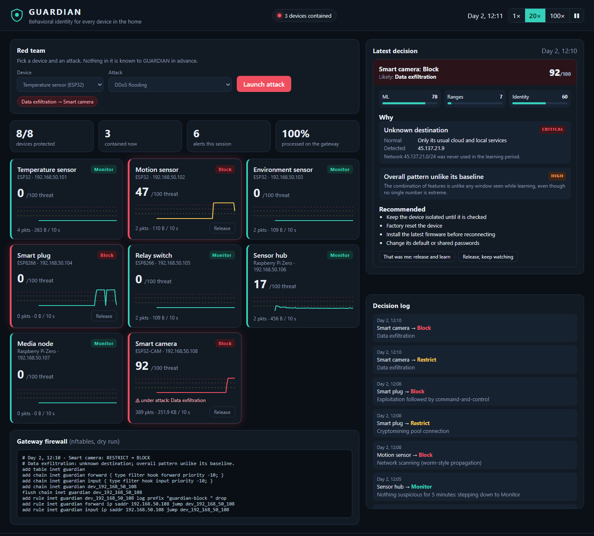
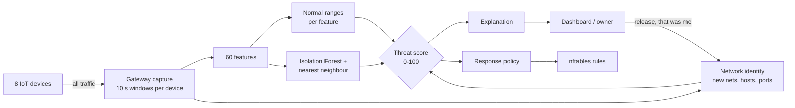

# GUARDIAN

**Behavioral identity for every device in the home.** GUARDIAN runs on the home
gateway, learns how each IoT device normally talks, and catches it when it stops
acting like itself: even when the attack is new and no signature exists. Every
decision comes with a plain-language reason, and the response is graduated, so a
doubtful detection never cuts off a working device.



*Dashboard while a network scan, a cryptominer and a data exfiltration hit three
devices at once. Each device is scored every 10 seconds; the panel on the right
shows why the camera was blocked.*

---

## Why it exists

A signature-based IDS asks *"is this a known attack?"* and has no answer for an
exploit nobody has written a rule for yet. Home IoT makes that worse: cheap
devices, rarely patched, often talking only to a cloud you can't inspect, and
traffic that is mostly encrypted.

GUARDIAN asks a different question: **"is this device acting like itself?"**
A temperature sensor publishes a few bytes to the local broker every 30 seconds.
If it suddenly opens connections to forty local hosts, or to a network it has
never used, that is visible from metadata alone, encrypted or not.

## What it does

| | |
|---|---|
| **Per-device identity** | One model per device, trained only on that device's normal traffic. A camera that uploads megabytes is normal; a plug that does the same is not. |
| **60 behavioral features** | Volume, rates, timing, protocol mix, network identity, connection behavior and time of day, every 10 seconds, from packet metadata only ([full list](docs/FEATURES.md)). |
| **Three detection layers** | Learned normal ranges, an ML layer (Isolation Forest plus nearest-neighbour distance), and network identity (never-seen destinations, networks and local hosts). |
| **Explanations** | Which behavior changed, what is normal for *this* device, what was seen instead, how severe, the likely attack, and what to do. |
| **Graduated response** | Monitor → Restrict → Quarantine → Block, enforced as nftables rules on the gateway. Restrictions lift after quiet periods; a block waits for the owner. |
| **Owner feedback** | "That was me" releases a device and teaches GUARDIAN the new destination, so legitimate changes stop alerting. |
| **Hybrid startup** | Fixed safety rules from minute one, learned ranges after 24 h, full protection after 48 h. |
| **Local only** | Nothing leaves the gateway. Scoring a device-window takes 0.05 ms at the median and 3 ms at the 99th percentile on a laptop. |

## Example: what an alert says

```
$ python -m guardian demo --device cam-1 --attack exfiltration
Learning Smart camera (ESP32-CAM) for 36 simulated hours...
Launching: Data exfiltration against Smart camera

[+    7s] threat  60.0  -> RESTRICT
          firewall: add rule inet guardian dev_192_168_50_108 log prefix "guardian-restrict " drop
[+   17s] threat  87.7  -> BLOCK

SMART CAMERA - threat 88/100
Likely: Data exfiltration

Why:
  1. Unknown destination [CRITICAL]
     Normal:   Only its usual cloud and local services
     Detected: 45.137.21.9
     Network 45.137.21.0/24 was never used in the learning period.
  2. Overall pattern unlike its baseline [HIGH]
     The combination of features is unlike any window seen while learning, even though no single number is extreme.

Recommended:
  - Keep the device isolated until it is checked
  - Factory reset the device
  - Install the latest firmware before reconnecting
  - Change its default or shared passwords
```

Note what is *not* in the explanation: "bytes sent". A camera streams up to
1.4 MB per 10 seconds to the home server every day, so the upload volume is
inside its normal range. What gives the attack away is the destination and the
combination of features. A generic model, or a fixed threshold, gets this wrong.

## How it works



**Scoring.** The three layers are combined with a noisy-OR: any one of them can
raise the threat alone, and agreement pushes it higher. The normal ranges are
each device's 0.1st-99.9th percentiles; the ML layer is calibrated on held-out
normal traffic (its 99th percentile scores 0, its 99.9th scores 30); the
identity layer is rule-based so that its evidence is something a person can
check. Tiers: 0-30 monitor, 31-60 restrict, 61-85 quarantine, 86-100 block.

**Two design decisions that came from measurement:**

- *Isolation Forest alone was not enough.* On sparse sensor traffic most windows
  are empty, so every ordinary check-in looked rare and attack windows scored
  *lower* than the normal tail. Training only on windows with traffic raised its
  separation (ROC AUC) from 0.82-0.93 to 0.97-0.99, and a nearest-neighbour
  distance was added because a forest cannot see values beyond its training
  range. The forest is scored with a flattened, vectorized implementation that
  matches scikit-learn exactly and is about 300x faster (0.05 ms vs 15 ms).
- *One-window spikes need corroboration.* Normal traffic produces the odd strange
  10 seconds; attacks last longer. Moderate ML and range evidence must persist in
  2 of the last 3 windows; the ML layer never acts on a single window, while strong
  range violations and never-seen networks count at once.

## Results (simulation)

GUARDIAN against a Snort-style signature IDS (bad ports, flood rates) and a
single generic model shared by all devices, on identical traffic. Three seeds,
each a 2-day learning period and a 24-hour test day in which every device
suffers every scenario once (5 minutes, random time of day). An alert is a
threat of 61+ (quarantine).

| Scenario | GUARDIAN | Generic model | Signature rules |
|---|---:|---:|---:|
| DDoS flooding | 100% | 100% | 100% |
| C&C beaconing | **87.5%** | 0% | 0% |
| Network scanning | 100% | 100% | 100% |
| Data exfiltration | **100%** | 100% | 0% |
| Cryptomining | 100% | 95.8% | 100% |
| Zero-day hybrid | 100% | 100% | 100% |
| **Average, 6 headline scenarios** | **97.9%** | 82.6% | 66.7% |
| *Bulk upload to a trusted destination* | *87.5%* | *0%* | *0%* |
| *Mimicry exfiltration* | *29.2%* | *0%* | *0%* |
| *Low-rate scan* | *100%* | *100%* | *100%* |
| False alerts per device per day | 0.65 | 0.00 | 0.00 |

Episodes detected (at least one alert while the attack ran), 24 per scenario.
Italic rows are the adversarial scenarios.

| Layer on its own | Headline detection | False alerts per device per day |
|---|---:|---:|
| ML (forest + nearest neighbour) | 95.8% | 0.30 |
| Normal ranges | 87.5% | 0.09 |
| Network identity | 50.0% | 0.00 |
| **All three (GUARDIAN)** | **97.9%** | **0.65** |

**How fast.** Median time from the start of an attack to GUARDIAN's first
restriction (threat 31+, which already blocks new internet destinations) and
to its first quarantine-level alert (61+):

| Scenario | First restriction | First alert |
|---|---:|---:|
| DDoS flooding | 5 s | 5 s |
| C&C beaconing | 6 s | 96 s |
| Network scanning | 5 s | 5 s |
| Data exfiltration | 5 s | 7 s |
| Cryptomining | 5 s | 15 s |
| Zero-day hybrid | 8 s | 8 s |

A beacon is a single small check-in every 20-45 seconds, so most 10-second
windows look normal. GUARDIAN restricts the device at the first check-in to a
never-seen network; escalating to quarantine waits until the ML layer has seen
the pattern twice.

> **Read these numbers carefully.** The home, the devices and the attacks are
> simulated, and the simulator and the detector were written by the same team.
> The results show that the pipeline works end to end and how its parts compare
> with each other and with the baselines. They are **not** real-world detection
> rates. The physical testbed ([plan](docs/TESTBED.md)) is the next step and will
> replace them. Full tables: [eval/results.md](eval/results.md).

**What the numbers say, honestly:**

- The signature IDS catches what has a signature: telnet scanning, mining-pool
  ports, floods. It misses C&C beaconing and exfiltration completely, because
  new infrastructure has no rule. That gap is the reason GUARDIAN exists.
- The generic model misses the beacon: one model for all devices cannot know
  that a plug never talks to a new network.
- No single layer is enough. Identity catches new destinations and nothing else;
  ranges miss attacks that stay inside normal volumes; the ML layer is the
  broadest but the noisiest.
- The adversarial scenarios are where behavioral detection runs out. An attacker
  who exfiltrates slowly *through a destination the device already uses* is
  caught only part of the time. GUARDIAN cannot see inside encrypted traffic, and
  the README will not pretend otherwise.
- False alarms are not zero. 0.65 false alerts per device per day in
  simulation means a few quarantines a day across a home. The graduated response
  (quarantine lifts after 5 quiet minutes) and the "that was me" button exist for
  this, and the testbed will show the real rate.

## Quick start

Python 3.11+.

```bash
python -m venv .venv && . .venv/bin/activate     # Windows: .venv\Scripts\activate
pip install -e ".[dashboard,dev]"

python -m guardian serve          # live dashboard on http://127.0.0.1:8000
python -m guardian demo --device plug-1 --attack cc_beacon
python -m guardian eval           # reproduces eval/results.md (about 8 minutes)
pytest -q
```

In the dashboard, pick a device and an attack under **Red team** and press
**Launch attack**. The home learns for 36 simulated hours first (about 20
seconds), then runs at 20x real time.

**Real captures.** The same pipeline runs on packet captures from a gateway:

```bash
python -m guardian pcap --learn baseline.pcap --check suspect.pcap \
    --device cam=192.168.50.108 --device plug=192.168.50.104
python -m guardian export home.pcap --hours 1 --attack scan --device motion-1   # opens in Wireshark
```

## Scenarios

| Scenario | What the compromised device does |
|---|---|
| DDoS flooding | SYN and UDP flood towards one internet target |
| C&C beaconing | Small TLS check-ins to a new server every 20-45 s |
| Network scanning | SYN probes to local hosts on telnet, SSH, HTTP, TR-069 ports |
| Data exfiltration | Sustained upload to a new internet host |
| Cryptomining | Persistent stratum connection to a mining pool |
| Zero-day hybrid | Inbound exploit, DNS lookups of generated domains, rotating C2, slow probing |
| *Bulk upload to a trusted destination* | *Stolen data streamed to a destination the device already uses* |
| *Mimicry exfiltration* | *Extra check-ins to the device's own cloud, sized like normal ones* |
| *Low-rate scan* | *One probe every 15-40 seconds* |

The last three are adversarial: they are designed to look normal and are
reported separately.

## Project layout

```
src/guardian/
  net.py          packet record and address helpers
  devices.py      the eight simulated devices
  attacks.py      six attack scenarios + three adversarial ones
  features.py     the 60 features and per-device context
  detector.py     normal ranges, ML layer, network identity, startup rules
  fastforest.py   vectorized Isolation Forest scoring
  explain.py      plain-language explanations and attack naming
  response.py     graduated tiers, nftables rules, enforcement backends
  engine.py       gateway engine: learning phases, scoring, response, release
  capture.py      pcap reader/writer (no dependencies)
  evaluate.py     reproducible evaluation against the baselines
  server.py       live simulated home + dashboard API
  web/            dashboard (vanilla JS, no build step, no CDN)
tests/            pytest suite
eval/             committed evaluation results
docs/             feature reference, testbed plan, screenshots
```

## Limits

- **Simulated evaluation.** See above. Real devices will be noisier and
  stranger than the simulator.
- **Metadata only.** Encrypted payloads are never inspected. Attacks that stay
  inside a device's normal destinations and volumes can evade detection.
- **Learning period.** A device is fully protected after 48 hours; until then
  only fixed rules and, after 24 hours, learned ranges protect it.
- **Poisoning.** A device that is already compromised while GUARDIAN learns will
  have the attack in its baseline.
- **Scale.** Designed for a home (8-20 devices) on one gateway.

## Roadmap

1. Physical testbed (8 devices + Raspberry Pi 4) and re-measured results.
2. Profile drift handling for firmware updates (ask before relearning).
3. Physical-layer identity (clock skew) as a fourth signal.
4. A user study of whether the explanations help owners act correctly.

---

Designed & Crafted by **lumidren**. MIT licence.
